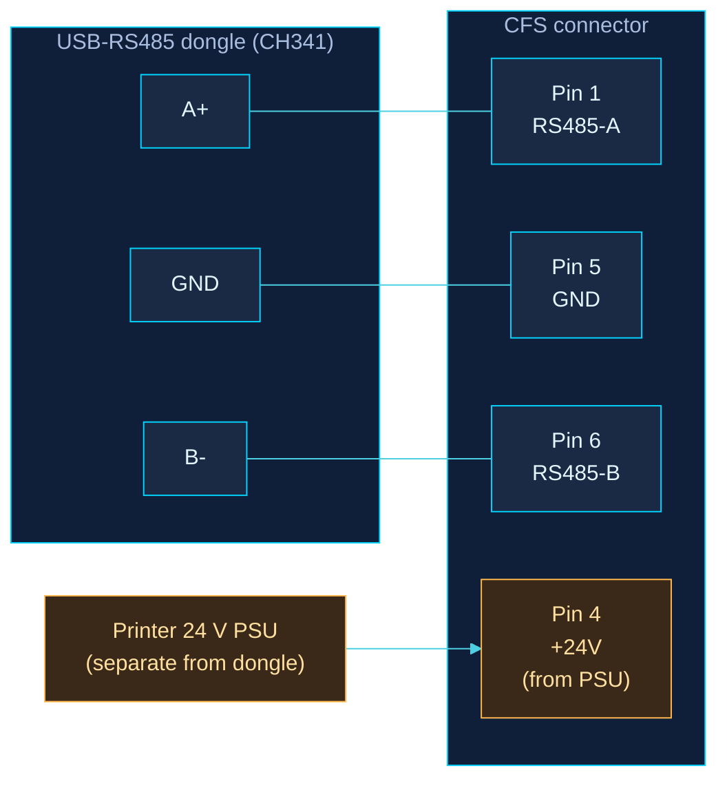
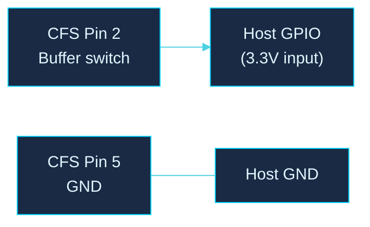
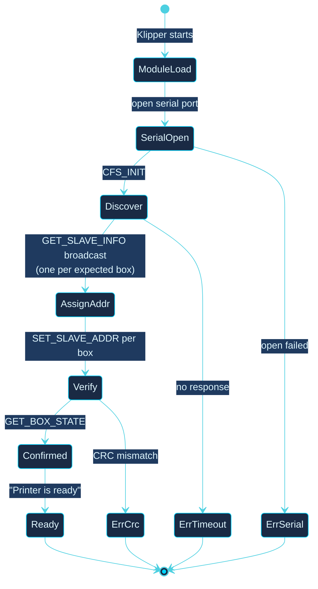
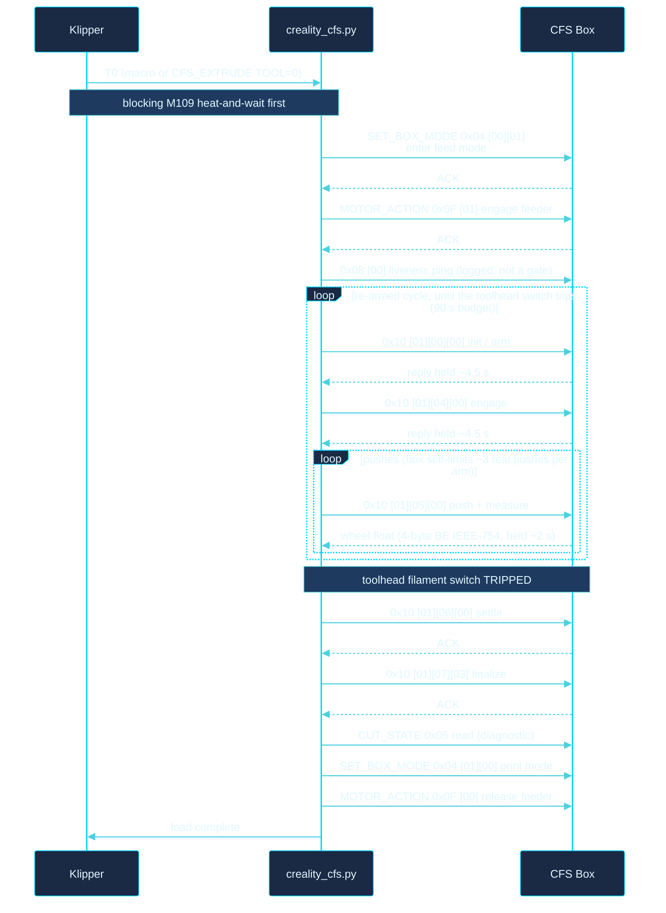

<div align="center">

# Installation Guide

### Creality CFS Klipper Integration

[](https://github.com/gitstonelabs/creality-cfs-klipper)
[](LICENSE)
[](#)

</div>

---

A complete walkthrough for installing the Creality CFS Klipper module on any Klipper-based 3D printer, including non-Creality hardware.

> **TL;DR:** Drop one Python file into Klipper's extras directory, add a 5-line config block, wire a $5 USB-RS485 adapter to the CFS connector, run `CFS_INIT`. Total time: ~15 minutes.

---

## Contents

1. [System overview](#system-overview)
2. [Hardware you need](#hardware-you-need)
3. [Wiring](#wiring)
4. [Software install](#software-install)
5. [First-boot verification](#first-boot-verification)
6. [Daisy-chaining multiple boxes](#daisy-chaining-multiple-boxes)
7. [Troubleshooting](#troubleshooting)
8. [Appendix: Tool-change anatomy](#appendix-tool-change-anatomy)

---

## System overview

Your Klipper host (anything that can run Klipper: Hi mainboard, Raspberry Pi, Jetson, BTT CB1, etc.) talks to the CFS box(es) over a half-duplex RS485 bus at 230400 baud. The module replaces Creality's proprietary `box_wrapper.cpython-39.so` + `serial_485_wrapper.cpython-39.so` binaries entirely.

```mermaid
%%{init: {'theme':'base','themeVariables':{
  'background':'#0a1428','primaryColor':'#1a2a44','primaryTextColor':'#e0f7ff',
  'primaryBorderColor':'#00d4ff','lineColor':'#4dd0e1','secondaryColor':'#1f3a5f',
  'tertiaryColor':'#163056','clusterBkg':'#0f1f3a','clusterBorder':'#00d4ff'}}}%%
flowchart LR
    subgraph Host["Klipper host (Pi / Jetson / printer mainboard)"]
        direction TB
        K[Klipper] --> M["creality_cfs.py<br/>(this module)"]
        M --> S["non-blocking fd transport<br/>(O_NONBLOCK + termios,<br/>reactor.register_fd)"]
    end
    S -->|"/dev/ttyUSB0<br/>or /dev/ttyS5"| A["USB-RS485 adapter<br/>(CH341 confirmed)"]
    A -->|"RS485 A / B / GND<br/>230400 8N1"| B1["CFS Box 1<br/>addr 0x01"]
    B1 -.->|optional daisy chain| B2["CFS Box 2<br/>addr 0x02"]
    B2 -.-> B3["..."]
    B3 -.-> B4["CFS Box 4<br/>addr 0x04"]

    classDef opt fill:#1f3a5f,stroke:#4dd0e1,color:#e0f7ff,stroke-dasharray:5 5;
    class B2,B3,B4 opt;
```



The module needs no pyserial and no pip packages: since v1.3.0 it opens the port itself (`os.open` with `O_NONBLOCK` plus raw 8N1 termios) and registers the fd with Klipper's reactor, so serial waits never block the Klipper event loop. RS485 direction switching is left to an auto-direction adapter by default; kernel RTS-as-DE mode is available via `rts_on_send`.

**Validated on:** Creality Hi (F018) with a CFS v1 box, and a K1 Max with the stock CFS (firmware 2.3.5.34, see [K1 Max install](#k1-max-install)). Transport, CRC, and addressing are capture-validated in this module; the load/unload/cut/flush choreography was hardware-validated on the reference implementation (same wire protocol, same printer), and this module's port of it is wire-faithful but has not yet been exercised on hardware itself.

**K1 family: RS485, same protocol as the Hi.** The operational opcodes are confirmed on the wire on a K1 Max. The K1 / K1C presets in `configs/printer.cfg.example` come from Creality's box.cfg and are untested; reports are welcome.

**K2 family: not supported.** The K2 Plus / K2 Max use CFS-C over CAN, which this module does not speak.

---

## Hardware you need

| Item | Notes |
|---|---|
| Klipper-compatible host | Pi 4/5, Jetson, BTT CB1/CB2, or the printer's own SBC |
| CFS box (at least one) | Stock Creality CFS (RS485). CFS-C (K2, CAN) is not supported. |
| USB-RS485 adapter **OR** mainboard RS485 port | CH341 chipset confirmed working. FTDI-based dongles also work. |
| 24 V PSU connection | The CFS draws ~24 V on pin 4 of its connector. Use your printer's PSU; the dongle carries data only. |
| 3 jumper wires or a CFS pigtail | A+, B-, GND. ~20 AWG is plenty. |
| *(optional)* GPIO pin on host | For the buffer-empty sensor (filament runout). |

**Approximate cost if you have nothing:** $5 USB-RS485 dongle + connector ≈ $10 total.

---

## Wiring

### The CFS 6-pin connector

Looking at the connector with the latch facing you:

```
            ╭────────────────────────────╮
   Pin 1 ───┤ RS485-A   (red wire)       │
   Pin 2 ───┤ Buffer switch              │ ── optional GPIO
   Pin 3 ───┤ NC                         │
   Pin 4 ───┤ +24 V     (red w/ stripe)  │ ←── from printer PSU, NOT dongle
   Pin 5 ───┤ GND       (green or black) │
   Pin 6 ───┤ RS485-B   (blue wire)      │
            ╰────────────────────────────╯
```

> ⚠ **Pin 4 is +24 V.** Connect it only to your printer's 24 V rail. Never to the USB-RS485 dongle. The dongle is GND + data only.

### USB-RS485 dongle → CFS



| Dongle pin | CFS pin | Function |
|---|---|---|
| A+ | Pin 1 | RS485 data line A |
| B− | Pin 6 | RS485 data line B |
| GND | Pin 5 | Common ground |
| *(none)* | Pin 4 | +24 V from **printer PSU only** |

### Optional: buffer-empty sensor

There is a single filament buffer at the end of the chain. It reports its state with a plain mechanical switch on pin 2 (referenced to pin 5 GND), going to 3.3V when triggered. It is **not** routed over RS485, and a 3-wire USB-RS485 dongle does not break out pin 2, so tap pin 2 and pin 5 off a CFS 6-pin connector and wire them to one 3.3V host GPIO input for buffer or runout detection. One buffer needs one GPIO; you do not need a buffer per box.



In `printer.cfg`:
```ini
[filament_switch_sensor cfs_buffer]
switch_pin: ^EBB:PA2     # any 3.3V GPIO; add ! to invert if it reads backwards
pause_on_runout: false   # we just want logging, not auto-pause
```

### Strongly recommended: toolhead filament sensor

This is a different switch from the buffer sensor above: the filament-runout switch at the **toolhead** that most CFS-capable printers already have. The module uses it to gate the whole load/unload choreography: a load feeds until this switch trips, an unload completes when it clears. Name its `[filament_switch_sensor <name>]` section in the module's `filament_sensor` option (see the config below). Without one, loads run a single ungated feed cycle and cannot confirm the filament actually reached the toolhead.

---

## Software install

### 1. Drop the module into Klipper

```bash
cd ~/klipper/klippy/extras/
wget https://raw.githubusercontent.com/gitstonelabs/creality-cfs-klipper/main/src/creality_cfs.py
```

Or, if you've cloned the repo:
```bash
cp src/creality_cfs.py ~/klipper/klippy/extras/
```

### 2. Drop the macros into your config (optional but recommended)

```bash
cp configs/cfs_macros.cfg ~/printer_data/config/
```

`cfs_macros.cfg` is the Hi macro set. On a K1 Max use `cfs_k1max.cfg` instead, not both: see [K1 Max install](#k1-max-install).

On mainline Klipper, add a `[respond]` section to `printer.cfg` if it has none. `cfs_macros.cfg` does not contain one, and without it every `RESPOND` in the macros fails with `Unknown command:"RESPOND"`. Kalico loads `respond` on its own.

### 3. Edit `printer.cfg`

Minimum block, substitute the serial port for your hardware:

```ini
# USB-RS485 adapter (most common)
[creality_cfs]
serial_port: /dev/serial/by-id/usb-1a86_USB_Single_Serial_*-if00
baud: 230400
box_count: 1

# Optional macros
[include cfs_macros.cfg]
```

For the **Creality Hi onboard RS485** (UART5):
```ini
[creality_cfs]
serial_port: /dev/ttyS5
baud: 230400
box_count: 1
```

Full config with every option exposed (mirrors `configs/printer.cfg.example`):
```ini
[creality_cfs]
serial_port: /dev/ttyUSB0
baud: 230400              # always 230400, non-negotiable for CFS
timeout: 0.1              # short-query command timeout; the load/unload
                          # choreography manages its own longer per-stage timeouts
retry_count: 3            # retries for failed query commands (choreography
                          # stage frames are always single-shot, stock behavior)
box_count: 1              # CFS CONTROLLERS in the daisy chain (1-4), NOT slots;
                          # one 4-slot CFS = box_count: 1
auto_init: True           # run CFS_INIT automatically on klippy:ready

filament_sensor: filament_sensor
#   Name of the TOOLHEAD [filament_switch_sensor <name>] section. This switch
#   gates the load (feed until it trips) and the unload (done when it clears).
#   STRONGLY recommended: without one, loads run a single ungated cycle and
#   cannot confirm the filament arrived.

extrude_temp: 220
#   Default melt temperature for loads/unloads/flushes/cuts. Every filament
#   move blocks on M109 to this first (170 C floor). Override per-material
#   with TEMP= on CFS_EXTRUDE/CFS_RETRUDE/CFS_FLUSH/CFS_CUT.

#load_max_bursts: 5       # per-arm 0x05 push cap during a load (the box
                          # self-limits to ~3 real pushes per arm; the loop
                          # re-arms automatically)
#load_wall_budget: 90     # wall-clock ceiling (s) for the whole sensor-gated load

# Filament cutter (required for CFS_CUT; leave unset if you have no cutter)
#cut_switch_pin: !toolhead_mcu:PB1   # cutter microswitch/hall pin; CFS_CUT
                                     # REFUSES to run without it
#pre_cut_pos_x: 240
#pre_cut_pos_y: 130
#cut_pos_x: 283.5
#cut_pos_x_max: 285       # travel bound on the ram target
#cut_velocity: 3000

# Flush (CFS_FLUSH) tuning
#nozzle_volume: 108       # melt-zone volume (mm^3); flush base = nozzle_volume / 2.4 (stock default 108)
#flush_multiplier: 1.0    # scales the slicer VOLUME= contribution
#flush_cycle_cap: 80      # per-cycle purge cap (mm)
#flush_default_len: 140   # total purge fallback when no LEN=/VOLUME= given
#buffer_empty_len: 30     # buffer capacity (mm, stock default 30); the flush clog
                          # watchdog arms only for cycles >= 2x this length
#flush_velocity: 360
#nozzle_clean_macro: WIPE_NOZZLE   # optional [gcode_macro] run once per flush cycle

# K1-family stock parity and idle behaviour; every default is the Hi behaviour.
# Descriptions in configs/printer.cfg.example, K1 Max values in configs/cfs_k1max.cfg.
#load_finalize: True
#release_feeder_after_load: True
#retrude_pull_len: 15
#retrude_pull_velocity: 360
#cut_switch_button: cfs_cut_switch
#heartbeat_interval: 0        # idle 0x0A poll (s); 0 = off
#idle_presence_poll: True
#k1max_connect: False
#loader_wake: False
#detect_path_on_connect: False
#buffer_recheck_s: 0
#box_sensor: cfs_box
#box_env: False               # True by default when box_sensor is set
#afc_compat: False
#lane_data_file: <printer.cfg directory>/cfs_lanes.json
#afc_extruder: extruder

# Park guard (cfs_k1max_simpleaf.cfg sets both); empty by default, which wraps nothing.
#park_guard:          # comma-separated commands; park_guard_gcode runs right before each
#park_guard_gcode:    # G-code run first, e.g. _CFS_CHUTE_ESCAPE; empty = off
```

> 💡 **Prefer `by-id` paths over `/dev/ttyUSB0`** when using USB adapters. `ttyUSB0` can shift when you plug in other USB devices. `ls /dev/serial/by-id/` to find your adapter's stable path.

> 🌡 **Heat-and-wait is by design.** Mainline Klipper keeps the `min_extrude_temp` protection that Creality's fork deletes, and the box-motor feed bypasses Klipper's cold-extrude protection entirely. So every `CFS_EXTRUDE` / `CFS_RETRUDE` / `CFS_FLUSH` / `CFS_CUT` first runs a blocking `M109` to `extrude_temp` (or `TEMP=`) and enforces a 170 C floor. A load that appears to "hang" right after you issue it is usually just the hotend heating.

### 4. Restart Klipper

```bash
sudo systemctl restart klipper
```

### K1 Max: automatic install

`install.sh` does the steps of the two K1 Max sections below for you. It works on SimpleAF and on mainline Klipper or Kalico, and picks the right one by itself: SimpleAF is detected by `/usr/data/pellcorp.done`.

SimpleAF (as root on the printer):

```bash
git clone -b k1-simpleaf https://github.com/Nico2433/creality-cfs-klipper.git /usr/data/creality-cfs-klipper
sh /usr/data/creality-cfs-klipper/install.sh
```

Mainline Klipper or Kalico (as the Klipper user):

```bash
git clone -b k1-simpleaf https://github.com/Nico2433/creality-cfs-klipper.git ~/creality-cfs-klipper
sh ~/creality-cfs-klipper/install.sh
```

It does the following:

- links `creality_cfs.py` and `abortable_waits.py` into `klippy/extras/`. On SimpleAF it also installs `S54cfs_module`, which recreates the links on every boot;
- copies `cfs_k1max.cfg` (and on SimpleAF `cfs_k1max_simpleaf.cfg`) to `config/macros/`, with `lane_data_file` set to `config/cfs/cfs_lanes.json`;
- adds `[include macros/...]` to `printer.cfg` after the last include and above `SAVE_CONFIG`. It replaces an old `[include cfs.cfg]` or root-level include;
- adds `[update_manager creality_cfs]` to `moonraker.conf`, for the checkout's origin and branch, so Fluidd and Mainsail can update the module;
- warns when `[stepper_y] position_max` is below 306;
- restarts Moonraker and Klipper, then reports whether the box connected.

Running it again only changes what is different. Every file it edits is first backed up to `printer_data/cfs-backups/<date>/`. Options:

- `--dry-run`: show the changes without making them;
- `--uninstall`: remove everything it added (the slot data in `config/cfs/` is kept);
- `--keep-config`: keep `macros/*.cfg` files you have edited;
- `--no-restart`;
- `--mode simpleaf|mainline`, `--klipper-dir`, `--printer-data`: for non-standard paths.

Still yours to do:

- the slicer G-code ([configs/SLICER_GCODE_K1MAX.md](configs/SLICER_GCODE_K1MAX.md));
- on mainline, calling the `CFS_PRINT_*` hooks from your print macros (step 4 below);
- on SimpleAF, saving your config overrides before a SimpleAF update, because it regenerates `printer.cfg` and `moonraker.conf`.

### K1 Max install

Tested on a K1 Max running plain Klipper with the stock CFS (firmware 2.3.5.34, board `CR4CU220812S11`) on the stock CH340 adapter. `configs/cfs_k1max.cfg` holds the whole setup: the `[creality_cfs]` block, both nozzle-board switches, the tool-change macros (T0-T3, `CFS_TOOL`, `CFS_UNLOAD`) and the print hooks. It replaces `cfs_macros.cfg`; do not include both, since both define T0-T3.

1. Copy the module and the config:

   ```bash
   cp src/creality_cfs.py ~/klipper/klippy/extras/
   mkdir -p <your printer.cfg directory>/macros
   cp configs/cfs_k1max.cfg <your printer.cfg directory>/macros/
   ```

   `cfs_k1max.cfg` contains `[respond]`, which mainline Klipper needs for the macros' `RESPOND` messages (the `CFS_MENU` dialog, the cut-switch messages). Without it every `RESPOND` fails with `Unknown command:"RESPOND"`. Kalico loads `respond` on its own.

2. In `printer.cfg`, include it and make room for the cut:

   ```ini
   [include macros/cfs_k1max.cfg]

   [stepper_y]
   position_max: 307.5   # must be >= 306: the cut presses at Y306 (stock 307.5)
   ```

3. Check the settings in `cfs_k1max.cfg` against your machine:
   - `serial_port: /dev/serial/by-id/usb-1a86_USB_Serial-if00-port0`. Confirm with `ls /dev/serial/by-id/`.
   - The toolhead filament switch is `[filament_switch_sensor filament_sensor_2]` on `^!nozzle_mcu:PA10`. The cutter switch is `nozzle_mcu:PA8` (`cut_switch_pin` and `[gcode_button cfs_cut_switch]`). Remove any other section that uses PA8 or PA10, such as an older preset that put `filament_sensor_2` on PA8.
   - `lane_data_file` points to `/usr/data/printer_data/config/cfs/cfs_lanes.json`. The directory must exist; change the path if your config lives elsewhere.
   - Keep `afc_compat: True`: T0-T3, `CFS_PRINT_START` and `CFS_MENU` read the AFC objects it registers (`printer.AFC`, `AFC_lane slot1..4`).
   - Leave `cut_pos_x` unset. The stock box.cfg value (38) equals `pre_cut_pos_x`, and `CFS_CUT` refuses a zero-travel X ram; without it the cut rams along Y to `cut_pos_y: 306`.

4. Call the hooks from your own print macros:

   | Macro | Add | Where |
   |---|---|---|
   | `START_PRINT` | `CFS_PRINT_START INITIAL_TOOL={params.INITIAL_TOOL} TEMP={params.EXTRUDER_TEMP}` | after homing, heating and the bed mesh, before the purge line; the slicer start G-code passes `INITIAL_TOOL=[initial_tool]` |
   | `END_PRINT` | `CFS_PRINT_END` | before the heaters turn off |
   | `CANCEL_PRINT` | `CFS_PRINT_CANCEL` | before `CANCEL_PRINT_BASE` |
   | `RESUME` | `CFS_RESUME_CHECK` | before `RESUME_BASE` |
   | `PAUSE` / `CANCEL_PRINT` park macros | `_CFS_CHUTE_ESCAPE` | first line |

   `CFS_PRINT_END` runs its unload through `CFS_TRY`, so a jammed unload is reported and `CANCEL_PRINT` still completes. The slicer change-filament G-code is described at the end of `cfs_k1max.cfg`.

5. Fans: the stock K1 fans are `output_pin` fan0/1/2 behind an `M106` macro, with no `[fan]` section; the stock chamber fan is `exhaust_fan`. The chute macros drive the part fan through `M106`, so they work with that. `variable_aux_fan` in `_CFS_SETTINGS` only accepts a `[fan_generic]` name, so leave it `""` on stock fans.

6. Restart Klipper. With `heartbeat_interval: 4` the box front LEDs stop blinking red, and `box_sensor: cfs_box` publishes the box temperature and humidity as `temperature_sensor cfs_box`.

The tool change runs: z-hop, cut, lift to Z30, unload to the box, move to the rear purge chute (185, 305.5) by way of Y291.5, load the new slot, purge, back to the print. The stock nozzle wipe is skipped (see the header of `cfs_k1max.cfg`).

### K1 Max with SimpleAF

SimpleAF is Pellcorp's Kalico-based K1 firmware. Its `START_PRINT`, `END_PRINT`, `CANCEL_PRINT`, `RESUME` and runout handling call `_SAF_*` hook macros; `configs/cfs_k1max_simpleaf.cfg` maps them to the CFS calls. It is an overlay on `cfs_k1max.cfg`: Klipper merges a repeated section option by option and the later value wins, so the overlay only adds or overrides the SimpleAF pieces.

Tested on a K1 Max running SimpleAF with an Eddy probe (EddyNG). The probe is side-mounted and hits the cleaning station behind the chute, which is why the stock nozzle wipe is skipped.

Step 3 of the K1 Max install still applies, and so does the `[stepper_y]` `position_max` from step 2. The hooks below replace step 4, and the overlay sets the aux fan of step 5.

1. Clone this repo outside the printer config, so Fluidd only shows `.cfg` files and Moonraker can update the code. Then copy the two config files:

   ```bash
   git clone --branch k1-simpleaf https://github.com/Nico2433/creality-cfs-klipper.git /usr/data/creality-cfs-klipper
   mkdir -p /usr/data/printer_data/config/macros /usr/data/printer_data/config/cfs
   cp /usr/data/creality-cfs-klipper/configs/cfs_k1max.cfg /usr/data/creality-cfs-klipper/configs/cfs_k1max_simpleaf.cfg /usr/data/printer_data/config/macros/
   ```

   `config/cfs/` only holds `lane_data_file` (`cfs_lanes.json`).

2. Link the module and the extra into Klipper on every boot. A SimpleAF or Klipper update can remove the links; `S54cfs_module` recreates them before Klipper starts (`S55klipper_service`):

   ```bash
   cp /usr/data/creality-cfs-klipper/configs/S54cfs_module /etc/init.d/
   chmod +x /etc/init.d/S54cfs_module
   /etc/init.d/S54cfs_module start
   ```

   It links `creality_cfs.py` and `abortable_waits.py` from `/usr/data/creality-cfs-klipper/src/` into `/usr/data/klipper/klippy/extras/`.

3. In `/usr/data/printer_data/config/printer.cfg`, below the SimpleAF includes (in place of any earlier `[include cfs.cfg]`):

   ```ini
   [include macros/cfs_k1max.cfg]
   [include macros/cfs_k1max_simpleaf.cfg]
   ```

   The order matters: `fan_control.cfg` and `client.cfg` must come before both, because the overlay replaces their `M141`/`M191` and the `runout_sensor` of `_CLIENT_VARIABLE`.

4. Let Moonraker update the module from Fluidd/Mainsail. In `/usr/data/printer_data/config/moonraker.conf`:

   ```ini
   [update_manager creality_cfs]
   type: git_repo
   path: /usr/data/creality-cfs-klipper
   origin: https://github.com/Nico2433/creality-cfs-klipper.git
   primary_branch: k1-simpleaf
   managed_services: klipper
   ```

   An update pulls the code and restarts Klipper. The two `.cfg` files in `config/macros/` are copies: after an update that changes them, copy them again. SimpleAF regenerates `moonraker.conf` and `printer.cfg` on its own updates, so save your changes with its config overrides first.

5. Restart Moonraker and Klipper.

What the overlay sets:

| Section | Does |
|---|---|
| `_SAF_START_PRINT_START` | chamber target, `CFS_AUTO_MAP`, toolhead switch on, `CFS_FEEDER ENABLE=1` (a missing filament fails before the heat soak) |
| `_SAF_START_PRINT_BEFORE_BED_MESH` | `CFS_TOWER_AREA` (the adaptive mesh covers the prime tower), chamber wait |
| `_SAF_START_PRINT_BEFORE_LINE_PURGE` | side fan off, `CFS_TOOL` for `INITIAL_TOOL` |
| `_SAF_END_PRINT_START` | `CFS_PRINT_END` (filament back to the box), chamber reset |
| `_SAF_ON_CANCEL` | `CFS_PRINT_CANCEL`, chamber reset |
| `_SAF_ON_FILAMENT_RUNOUT` | `_CFS_ON_RUNOUT_RUN` (SimpleAF has already paused) |
| `_SAF_ON_RESUME` | `CFS_RESUME_CHECK` |
| `[filament_switch_sensor filament_sensor_2]` | `runout_gcode: _ON_FILAMENT_RUNOUT`, SimpleAF's handler |
| `_CLIENT_VARIABLE` | `runout_sensor: ""`: the stock rear sensor is out of the CFS path, so SimpleAF's own check is off |
| `_CFS_SETTINGS` | `aux_fan: "auxiliary"`, SimpleAF's side fan, off during a colour change |
| `[creality_cfs]` | `park_guard: _TOOLHEAD_PARK_PAUSE_CANCEL, _TOOLHEAD_PARK_END_PRINT` and `park_guard_gcode: _CFS_CHUTE_ESCAPE`: the toolhead leaves the chute along Y before SimpleAF parks it |
| `[abortable_waits]` | a cancel stops the print start's heating and soak waits |
| `_WARP_STABILISE` | SimpleAF's bed soak, with `ABORTABLE_WAIT` instead of `G4` |
| `M141` / `M191` | chamber target / set and wait. The K1 Max has no chamber heater: the target is where `temperature_fan chamber_fan` starts, and the bed heats the chamber |

`park_guard` / `park_guard_gcode` (`[creality_cfs]`): a load or purge that fails at the chute leaves the toolhead there, and `CANCEL_PRINT`/`PAUSE` then park diagonally across the cleaning station. At connect the module wraps each command listed in `park_guard` (comma-separated) so `park_guard_gcode` runs right before it. A listed command that does not exist is logged and skipped. Both default to empty, which wraps nothing.

`[abortable_waits]` (no options; needs `abortable_waits.py`): a `CANCEL_PRINT` from the web UI or the touchscreen normally queues behind the whole `START_PRINT`. With this section, `M109`, `M190` and `TEMPERATURE_WAIT` check for a cancel every second and stop with `Print cancelled`, and `ABORTABLE_WAIT SECONDS=` is a dwell that does the same. A command that a `gcode_macro` already overrides is left alone. Limits:

- It uses Klipper/Kalico internals (`webhooks._endpoints`, `heaters._get_temp`, `gcode.gcode_help`, the `gcode/script` endpoint). If one is missing, Klipper stops with a config error naming it: remove `[abortable_waits]`.
- Its `TEMPERATURE_WAIT` ignores Kalico's `ALLOW_CANCEL` parameter.

Slicer G-code: `START_PRINT` must pass `INITIAL_TOOL`, and the change-filament G-code sets the next temperature and purge length. The lines for OrcaSlicer, Creality Print and PrusaSlicer are in [configs/SLICER_GCODE_K1MAX.md](configs/SLICER_GCODE_K1MAX.md).

GrumpyScreen: `configs/grumpyscreen_k1max.ini` points Load at `CFS_MENU` and Unload at `CFS_UNLOAD`, and shows `temperature_sensor cfs_box`. Copy it over `/usr/data/printer_data/config/grumpyscreen.ini` and run `/etc/init.d/S99guppyscreen restart`.

Test prints: `configs/cfs_test_2colores.gcode` (two colours), `cfs_test_runout.gcode` (runout, recovery on another slot) and `cfs_test_refill.gcode` (auto-refill; send `_ON_FILAMENT_RUNOUT` from the console during layer 1).

#### Deploy without SSH

With the git checkout, the code updates from Fluidd/Mainsail (step 4). The `.cfg` files can be uploaded through Moonraker's file API (`<printer>` is the printer's address):

```bash
curl -F file=@configs/cfs_k1max_simpleaf.cfg -F root=config -F path=macros http://<printer>:7125/server/files/upload
curl -X POST "http://<printer>:7125/machine/services/restart?service=klipper"
```

After a `.py` change restart the Klipper service, not just `FIRMWARE_RESTART`. `/etc/init.d/` is outside Moonraker's roots, so installing `S54cfs_module` needs SSH once.

---

## First-boot verification

The boot-up sequence the module runs:



Run these from the Klipper console (Mainsail, Fluidd, or Moonraker terminal) **in order**:

### Step 1: Module loaded

`grep creality_cfs /var/log/klipper/klippy.log` should show:
```
creality_cfs: module loaded, port=/dev/ttyUSB0 baud=230400
```

If this line is absent, jump to [troubleshooting](#troubleshooting).

### Step 2: Auto-addressing

```
CFS_INIT
```

Expected (for `box_count=4`):
```
CFS auto-addressing complete: 4/4 box(es) online
```

`0/N online` → check wiring polarity, baud rate, and PSU power.

> ⏱ **Init takes a while by design.** After address assignment the box's slave MCU needs ~9.5 s to wake, so the module probes it with a single 12 s shot (plus bounded retries) before running the connect-init burst; the all-slot presence read alone takes ~11 s. A quiet console for 20-30 s during `CFS_INIT` is normal, not a hang.

### Step 3: Firmware versions

```
CFS_VERSION
```

Each box returns its serial + firmware string:
```
Box 1 (0x01): 1101000084321 5B625AHSC
```

### Step 4: Live state

```
CFS_STATUS
```

```
Box 1 (0x01): FEEDING raw=1a200000
```

`LOADED` means the box is print-locked to a slot; `FEEDING` means it is in feed/change mode. A `[busy/cal active]` suffix means the box is mid-calibration or mid-retract (normal transiently); `[insert event]` means a spool was just inserted. The raw hex is the 4-byte `GET_BOX_STATE` word; see [state decode](#box-state-decode-from-cfs_status) below for what the bytes mean.

### Step 5: Test load + retract

Load a spool into slot A (the first slot), then:

```
CFS_EXTRUDE TOOL=0
CFS_RETRUDE TOOL=0
```

`TOOL=` selects the slot (0-3 for A-D); `BOX=` is only needed on multi-controller daisy chains. Both commands first run a blocking `M109` heat-and-wait to `extrude_temp` (default 220 C), so expect the hotend to heat before anything moves. The load then feeds in sensor-gated bursts until the toolhead filament switch trips (~400 mm path on the reference printer); the unload runs the box's start/finish retract pair with one toolhead pull in between, and completes when the switch clears. If the load times out with "filament did not reach the toolhead", check for a jam at the 4-way splitter and confirm `filament_sensor` points at the right switch.

---

## Daisy-chaining multiple boxes

CFS boxes connect in a chain. Each box has an upstream RS485 connector (toward the host) and a downstream one (to the next box).


### Addressing

Addresses are assigned **dynamically** by `CFS_INIT`: no DIP switches, no manual numbering. The protocol does:

1. Host broadcasts `GET_SLAVE_INFO` with sequence index 1.
2. The **physically-closest box** (the one wired to the host) responds.
3. Host assigns it address `0x01` via `SET_SLAVE_ADDR`.
4. Repeat for index 2, 3, 4, each box farther down the chain.
5. Boxes already addressed stay silent during subsequent rounds.

Re-run `CFS_INIT` any time you change the chain order or hot-swap a box.

### Bus terminator

Most USB-RS485 adapters provide their own A/B bias and termination, so you usually do not need to add a resistor. The common Waveshare USB-RS485 is just A, B, and GND and handles this itself. Some Pi and Jetson RS485 HATs have a 120 Ω jumper, but on those it is often for the CAN side, so check the board before enabling it. If the bus is flaky on a long chain (more than ~2 m), add a 120 Ω resistor across A/B at the far end, after the last box. Short or single-box chains generally do not need one.

---

## Troubleshooting

Quick decision tree:

```mermaid
%%{init: {'theme':'base','themeVariables':{
  'background':'#0a1428','primaryColor':'#1a2a44','primaryTextColor':'#e0f7ff',
  'primaryBorderColor':'#00d4ff','lineColor':'#4dd0e1','secondaryColor':'#1f3a5f'}}}%%
flowchart TD
    Start[Issue:] --> Q1{Did<br/>klippy.log show<br/>module loaded?}
    Q1 -->|No| F1[Check creality_cfs.py is in<br/>klipper/klippy/extras/<br/>and printer.cfg has<br/>&#91;creality_cfs&#93;]
    Q1 -->|Yes| Q2{Does<br/>CFS_INIT find<br/>any boxes?}
    Q2 -->|0/N| Q3{Serial port<br/>open OK?}
    Q3 -->|No| F2[ls -la device path<br/>add user to dialout<br/>try a different port]
    Q3 -->|Yes| F3[Check A/B polarity<br/>verify 24V at CFS pin 4<br/>verify GND continuity]
    Q2 -->|partial| F4[Increase timeout to 0.5<br/>run CFS_INIT twice<br/>check long-chain termination]
    Q2 -->|all OK| Q4{CRC errors<br/>in log?}
    Q4 -->|Yes| F5[Verify baud=230400<br/>shorten cable<br/>add 120R terminator]
    Q4 -->|No| F6[Working. Check<br/>CFS_STATUS for box-specific<br/>state codes]

    classDef fix fill:#1f3a5f,stroke:#4dd0e1,color:#e0f7ff;
    classDef ok fill:#16352b,stroke:#3fcf8e,color:#c0f0d8;
    classDef warn fill:#3a2818,stroke:#ffb84d,color:#ffe0a0;
    class F1,F2,F3,F4,F5 fix;
    class F6 ok;
```



### Box state decode (from `CFS_STATUS`)

The `GET_BOX_STATE` (0x0A) reply is 4 data bytes `[b0][b1][b2][b3]`:

| Byte | Meaning | Values |
|---|---|---|
| `b0` `b1` | Carries **no** load state; never gate on it. On the K1 Max CFS, `b0` is the box temperature (°C) and `b1` the humidity (%RH), decoded when `box_env` is on. On the Hi it was documented as an opaque firmware base (`1a20`, `1b26`, `1c24`, `1d21` observed on identical hardware). | varies |
| `b2` | Substatus | `0x00` = OK |
| `b3` | The real load flag | `0x02` = loaded / print-locked, `0x00` = feed/change mode, `0x04` = busy (during a `0x16` event) |

The frame's STATUS byte doubles as the box's async event channel and is surfaced by `CFS_STATUS`:

| Event | Meaning | Action |
|---|---|---|
| `0x00` | Idle / steady | none |
| `0x30` | Insert/update push (spool inserted) | none |
| `0x16` | Busy / active calibration or retract | wait; only a problem if it never settles |

---

## Appendix: Tool-change anatomy

Internally `CFS_EXTRUDE` and `CFS_RETRUDE` run the full choreography ported from the hardware-validated reference implementation. There is no position streaming and no status polling: the box **holds each stage reply until the mechanical step completes** (init/finalize ~4.5 s, push ~2 s, unload finish ~9.6 s), so the blocking reply itself is the ready signal and per-stage timeouts are sized accordingly (15 s per load stage). Every 0x10/0x11 frame carries the slot as a data-byte bitmask (`T0`-`T3` → `0x01`/`0x02`/`0x04`/`0x08`); the example below uses slot A (`0x01`).

### Load (`CFS_EXTRUDE TOOL=0`)



The load is **sensor-gated**: the 0x05 push repeats, and the 0x06/0x07 finalize only fires after the toolhead filament switch trips, with the whole cycle re-armed (fresh `[slot] 00 00`) until the switch latches. The 0x05 push reply is the cumulative measuring-wheel position as a 4-byte big-endian IEEE-754 float (negative, magnitude grows as filament feeds); a per-push wheel-advance watchdog detects the box's no-op fast-acks and re-arms early.

### Unload (`CFS_RETRUDE TOOL=0`)

`CFS_RETRUDE` is **not** single-shot. It is a START/FINISH command pair, both frames carrying the slot bitmask, with one toolhead pull interleaved:

1. `0x04 [00][01]` enter feed mode, then a `0x08 [00]` material-sensor read.
2. **START** `0x11 [01][00]`; the reply arrives after ~12-14 s of real pulling.
3. One toolhead `G1 E-15 F360` pull (exactly once, values fixed by the reference implementation).
4. `0x08 [01]` connections read, then **FINISH** `0x11 [01][01]`; the ACK is held ~9.6 s while the box reels the filament fully in.
5. Completion is gated on the toolhead filament switch **clearing**, not on any reply status; the 0x11 reply statuses are diagnostic only. Whole unload bounded by a 60 s wall budget.

---

<div align="center">

**Part of the gitStoneLabs open hardware project family.**

[](LICENSE) · [Issues](https://github.com/gitstonelabs/creality-cfs-klipper/issues) · [Discussions](https://github.com/gitstonelabs/creality-cfs-klipper/discussions) · [Contributing](CONTRIBUTING.md)

</div>
